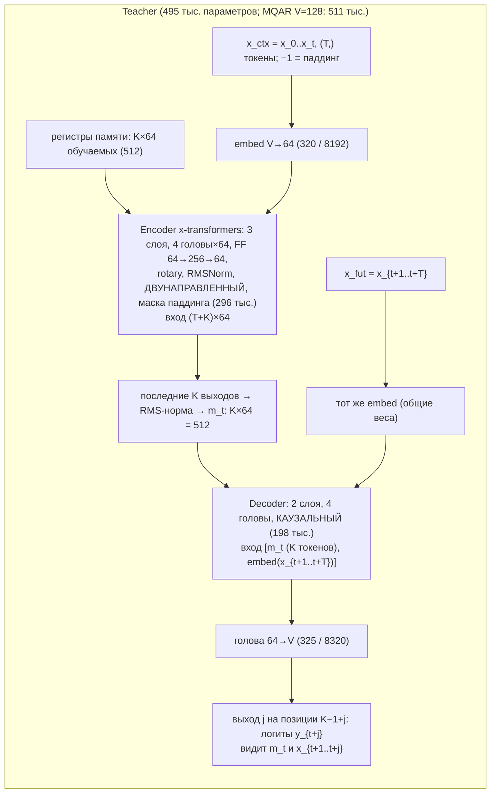
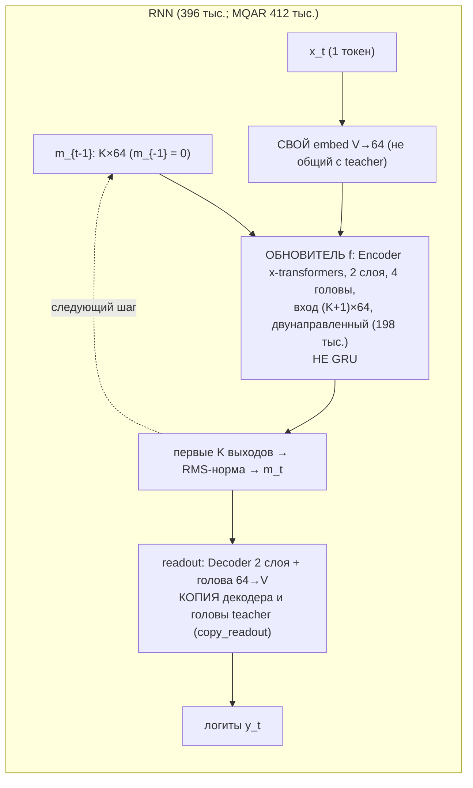
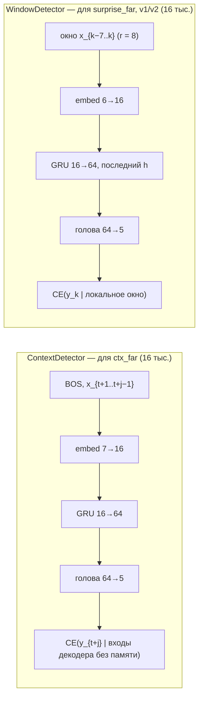
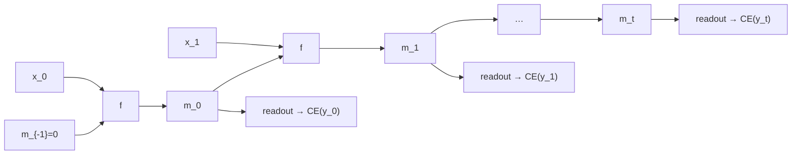
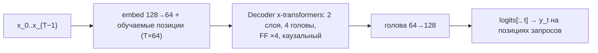
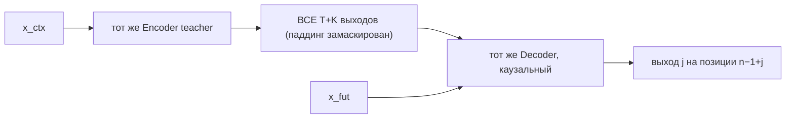
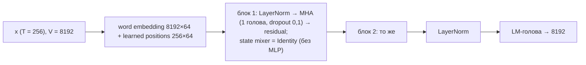

# Схемы обученных моделей

* **Размеры:** без пометок — Stack (V = 5, T = 64, d = 64, K = 8, 4 головы); для MQAR — V = 128.
* **Число параметров** посчитано на настоящих объектах (`smt_minimal.make_models`), кроме Zoology (там оценка по
  конфигу).
* **Подписи на схемах:**
  * ⟂ — нет градиента;
  * «копия» — веса копируются, но это **разные тензоры**;
  * «общие» — один и тот же тензор.

## 1. SMT: teacher (энкодер + декодер)

* **Вход:** `x_ctx` (N, T).
* **Выходы:**
  * `encode` → m_t (N, 512);
  * `decode(m_t, x_fut)` → (N, T, V);
  * `teacher_readout(m_t)` = выход j = 0, (N, V).
* **Код:** `upstream/smt/src/model.py:105-167`; создание — `smt_minimal.py:256-269`.
* **Обучение:** только в SMT (L_dec, L_far, L_unif; L_dyn — если не `dyn_detach="both"`). В DMT заморожен.

## 2. SMT: RNN = обновитель f + свой readout

* `rnn_update` — `model.py:200-215`; `rnn_readout` — `model.py:217-226`.
* **SMT:**
  * f и `embed` учатся только от L_dyn по одному шагу: вход — память teacher m_{t−1}, цель — m_t;
  * readout градиента не получает и перезаписывается копией teacher.
* **DMT:**
  * f учится по MSE к m_t на своих состояниях, с отцеплением между шагами;
  * readout учится по CE на отцепленных состояниях.
* **Итоговая модель SMT → DMT** — эта RNN: читает x_0..x_t по одному и выдаёт `readout(m^rnn_t)`.

## 3. Детекторы отбора целей — отдельные маленькие GRU (не обновитель SMT)

* Обучены один раз в версии 1 (2000 шагов), заморожены: `runs/stack02_4c69a2819ab8/detector_{context,window}.pt`.
* Скоры считаются под `no_grad`, отбор top-K градиента не имеет.
* **С обновителем f ничего не делят:** другой класс (`torch.nn.GRU`), другие веса, другая роль. f — Transformer-блок
  над K токенами памяти.
* Код: `smt_minimal.py:278-300`; `smt_memup_stack.py:434-481`.

## 4. Та же RNN, обученная прямо на ответах: full BPTT и BPTT-1

* **Модель:** тот же класс, размер (8×64), readout и **те же начальные веса** для того же сида, что у RNN из SMT. Teacher
  нет, DMT нет.
* **full BPTT:** градиент CE(y_t) идёт через все стрелки m_{t−1} → f → m_t назад до m_0.
* **BPTT-1:**
  * прямой проход тот же, состояние не обнуляется;
  * на каждой стрелке «m_{t−1} → f» стоит ⟂ (`rnn_rollout(detach=True)`, `smt_minimal.py:331`), поэтому CE(y_t)
    учит только f на шаге t и readout.
* Код: `smt_minimal.py:436-445`; архив — `smt_memup_v4.py:111-120`.
* Для MQAR это же — «RNN full BPTT» в `mqar_baselines.py` (класс `RecurrentLM`).

## 5. MQAR: обычный каузальный Transformer

* 215 тыс. параметров при T = 16.
* Код: `smt_minimal.py:303-314` = `mqar_baselines.py:97-105`.
* Отдельная модель: ни с чем не делит веса.

## 6. MQAR: teacher с полным доступом (диагностика узкого места)

* Те же веса и классы, что в п. 1, но вместо последних K выходов декодер читает все.
* **Одновременно меняются число доступных позиций (T+K против K) и способ чтения** (внимание к выходам по позициям).
  Поэтому успех этого режима не говорит, какой из двух факторов важен.
* Код: `smt_minimal.py:336-351`; архив — `checks/mqar_bottleneck_test.py:27-42`.

## 7. Zoology: авторская attention-конфигурация (воспроизведение рисунка 2)

* **Параметры:** ≈ 0,57 млн по конфигу, из них эмбеддинг 8192×64 = 0,52 млн. Точный подсчёт на CPU не выполнен:
  код Zoology создаёт эмбеддинг сразу на CUDA.
* **Обучение:** AdamW (wd 0,1), косинус на 64 эпохи, batch 256, 100k последовательностей, ранняя остановка при
  точности > 0,99, LR из {1e-4, 4,6e-4, 2,2e-3, 1e-2}.
* Код: `zoology_repro/configs.py`; модель — `upstream/zoology/zoology/model.py`.

## Общие и раздельные веса: сводка

| пара | отношение |
|---|---|
| embed teacher (для x_ctx) и embed teacher (для x_fut) | **общие** (один `teacher.embed`) |
| embed teacher и embed RNN | раздельные |
| декодер и голова teacher ↔ readout RNN | **копия**: при каждой оценке SMT и перед DMT; в DMT readout RNN учится отдельно |
| энкодер teacher и обновитель f | раздельные; f учится имитировать один шаг энкодера (L_dyn) |
| обновитель f и детекторы (GRU) | ничего общего |
| RNN из SMT → DMT и RNN из BPTT | одинаковая архитектура и инициализация при одном сиде; обучаются независимо |
