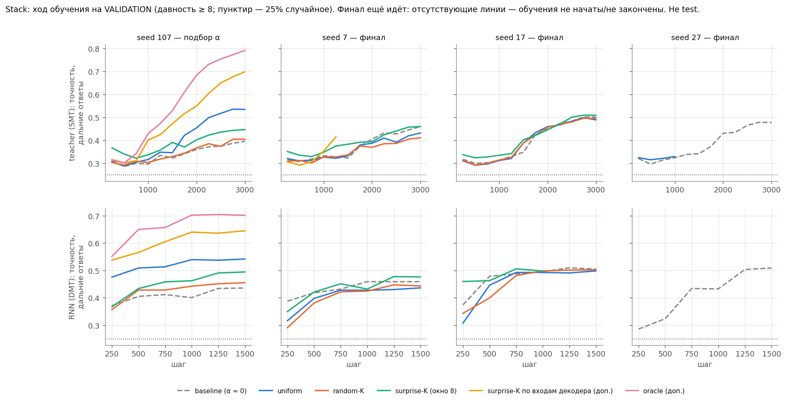
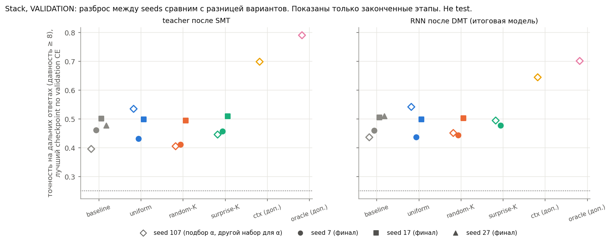
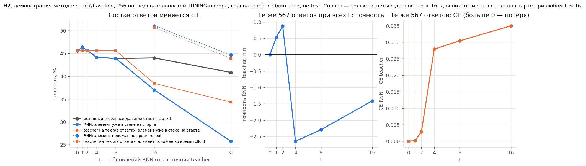
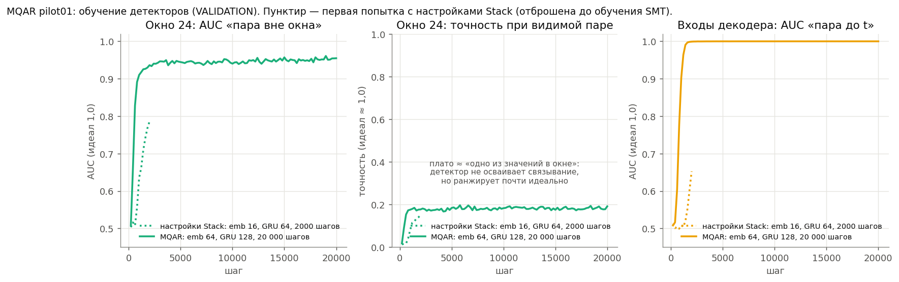
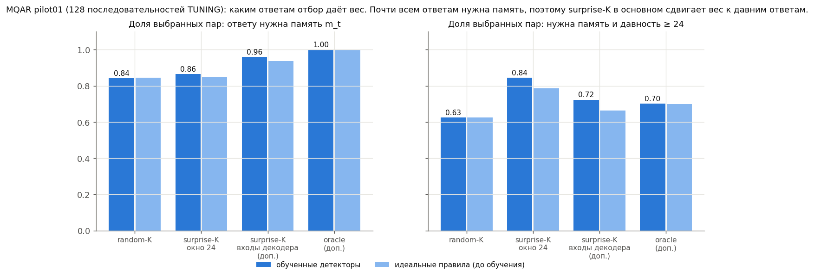
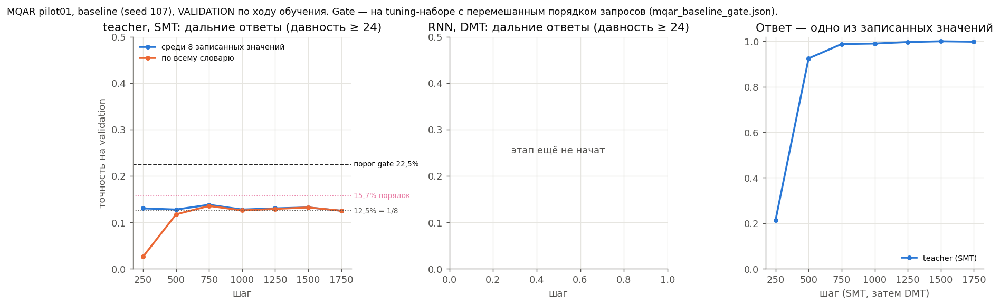

# Промежуточные результаты, 14.10.2026 (Stack — финал идёт, MQAR — baseline)

**Здесь нет test.** Все числа взяты с validation (по нему выбираются checkpoints) или с tuning-набора (по нему выбирались α).
Финальное сравнение Stack будет одно, на test, после всех 18 обучений и с разрешения. Рисунки и таблицы собирает
`python make_interim_figures.py` на CPU из сохранённых файлов.

Обозначения:
* **дальний ответ** в Stack — давность ≥ 8, случайный уровень 25%;
* **teacher** — энкодер и декодер SMT; **RNN** — итоговая рекуррентная модель после DMT;
* **seed 107** — обучения подбора α, **seeds 7/17/27** — финал (α уже зафиксированы, у всех вариантов 1,0).

---

## 1. Stack: ход обучения по seeds — `01_stack_validation_curves_by_seed.png`

Точность на дальних ответах по шагам: сверху teacher на этапе SMT, снизу RNN на этапе DMT. Столбцы соответствуют seeds.

* **Seed 107 (подбор α):** варианты хорошо разошлись — oracle > surprise-K по входам декодера > uniform > surprise-K > random-K ≈ baseline.
* **Финальные seeds 7 и 17:** четыре основных варианта (baseline, uniform, random-K, surprise-K) идут почти одной линией.
  Навык дальних ответов у всех «включается» скачком около шагов 1500–2000.
* **Вывод:** то, что выглядело заметной разницей на seed 107, во многом может быть удачей одного обучения.
  Поэтому эффект оцениваем по каждому seed, а не переносим результат подбора α.
* Пропущенные линии — обучения ещё идут или не начаты. Oracle и surprise-K по входам декодера в финале ещё не обучались.

## 2. Stack: разброс между seeds — `02_stack_seed_variability.png`

Лучший checkpoint каждого законченного этапа (выбран по CE на validation); полые ромбы — seed 107.
Таблица: `table_stack_best_validation_by_seed.csv`.

| дальние ответы, validation | baseline | uniform | random-K | surprise-K |
|---|---|---|---|---|
| RNN после DMT, seed 107 | 43,6% | 54,2% | 45,1% | 49,5% |
| RNN после DMT, seed 7 | 45,9% | 43,6% | 44,4% | 47,6% |
| RNN после DMT, seed 17 | 50,5% | 49,8% | 50,2% | идёт |
| RNN после DMT, seed 27 | 50,9% | идёт | идёт | идёт |

* **Разброс одного варианта между seeds сам по себе велик:** у baseline 43,6–50,9%, около 7 п.п.
* **Uniform:** на seed 107 он был сильнейшим контролем (+10,6 п.п. к baseline), а на seeds 7 и 17 он не лучше baseline.
* **Surprise-K:** на seed 7 он на 1,7 п.п. выше baseline. Один seed — это не вывод.
* Validation — не test и не независимая проверка. Решение по H1 — только по правилу предрегистрации на test.

## 3. H2: как правильно читать probe сохранения информации — `03_h2_method_seed7_baseline.png`

**Вопрос научника:** сохраняет ли RNN информацию энкодера при последовательных обновлениях?

**Как устроен probe.** RNN стартует с состояния teacher m_s, делает L своих обновлений и отвечает в момент q = s + L
через голову teacher. С ней сравнивается teacher в тот же момент q.

**Слева — почему исходный probe нельзя читать напрямую.** С ростом L меняется, какие ответы попадают в выборку, и смешиваются два случая:
* **элемент уже в стеке на старте** (source ≤ s): RNN должна **пронести** его через L обновлений;
* **элемент положен во время rollout** (source > s): RNN должна **записать** его сама.

Например, при L = 16 точность «уже в стеке» падает до 37%, но teacher на тех же ответах тоже даёт лишь 38,5%.
Падение почти целиком объясняется тем, что в группу остались только очень давние, трудные ответы.

**В середине и справа — чистое удержание.** Здесь одни и те же 567 ответов с давностью > 16: для них элемент лежит в стеке
на старте при любом L ≤ 16. По сравнению с teacher RNN теряет до 2,6 п.п. точности, а CE растёт на 0,028–0,035 при L ≥ 4.

**Итог для baseline на одном seed:** потеря информации при собственных обновлениях есть, но небольшая.
В финальном отчёте этот анализ будет для всех вариантов и seeds на test (`make_test_outputs.py --h2`).
По предварительным данным подбора α потеря больше у вариантов с более сильной памятью teacher (oracle, surprise-K по входам декодера).
Это надо проверить тем же исправленным анализом.

---

## 4. MQAR: детекторы — `04_mqar_detectors.png`

**Конфигурация MQAR — `pilot01`:** словарь 128, длина 64, 8 пар ключ–значение, K = 2, окно локального детектора r = 24.
Обоснование — `outputs_mqar/protocol_mqar_v1.md`.

**Первая попытка с настройками детекторов из Stack (пунктир) была недообучена:** AUC 0,79 и 0,64.
Её отбросили до какого-либо обучения SMT.

**Детекторы MQAR** — тот же GRU, но embedding 64, скрытое состояние 128, 20 000 шагов:
* **Оконный детектор** ранжирует ответы «пара вне окна» с AUC 0,95 (идеал 1,0).
  Но если пара видна в окне, он угадывает ответ лишь в ~18% случаев: выучил «одно из значений в окне», а не связывание ключа со значением.
  Для отбора top-K важно именно ранжирование, поэтому такой детектор пригоден.
* **Детектор по входам декодера** ранжирует идеально, AUC 1,00.

## 5. MQAR: каким ответам отбор даёт вес — `05_mqar_selection.png`

**Главное ограничение MQAR, известное до обучения.** Все пары записаны в первых 16 токенах.
Поэтому после 16-го токена **любому** будущему ответу нужна память, и даже random-K выбирает 84% таких пар.

**Что делает surprise-K (окно 24) на этой задаче:**
* почти не увеличивает долю ответов, которым нужна память (86%);
* сильно сдвигает вес к **давним** ответам: 84% дальних среди выбранных против 63% у random-K.

То есть на MQAR surprise-K — это в основном «усиление давних ответов», а не «отбор ответов, которым нужна память»
(в Stack второе было выражено сильнее).

**Обученные детекторы не хуже идеальных правил.** Значит, разница с random-K ограничена самой постановкой, а не качеством детектора.

## 6. MQAR: осваивает ли baseline связывание ключа со значением — `06_mqar_baseline_binding.png`

**Что проверяем.** Ответ на запрос — значение, записанное для этого ключа. «Знает набор значений» и «знает, какое значение
у какого ключа» — разные вещи. Поэтому смотрим:
* **точность среди 8 записанных значений.** Наугад — 12,5%; эвристика «r-й запрос → r-я пара» без связывания даёт 15,7%.
  Исключить уже спрошенные значения без связывания нельзя: ответы не подаются на вход;
* **gate:** teacher ≥ 22,5% и RNN после DMT ≥ 17,5% на дальних ответах. Считается на tuning-наборе с **перемешанным порядком
  запросов**, чтобы порядок не нёс информации.

**Сейчас (обучение идёт).** Teacher уже почти всегда отвечает одним из записанных значений, но среди них угадывает ~13%,
то есть на уровне случайного. Это плато «набор значений без связывания» — то же, что было в архивном пилоте 01.

**Если gate не будет пройден,** по заранее записанной лестнице сначала разбираем причину без обучения:
* по позициям anchors;
* по номеру запроса;
* teacher против RNN.

Затем пробуем по очереди: ×3 шагов SMT, lr 1e-3, d_model = 128. Подбор α — только после пройденного gate.

Стоимость (замер на RTX 5090 параллельно со Stack): SMT 0,12 с/шаг, пик 4,0 ГБ; DMT 0,20 с/шаг; одно обучение ≈ 0,19 ч.

---

## Файлы
* `table_stack_validation_histories.csv` — validation по шагам: финал seeds 7/17/27 и подбор α (seed 107).
* `table_stack_best_validation_by_seed.csv` — лучший checkpoint каждого законченного этапа.
* `table_h2_demo_seed7_baseline_tuning.csv` — H2-probe с разделением по моменту push (seed7/baseline, tuning-набор).
* `mqar_baseline_gate.json` — появится, когда baseline MQAR закончит обучение.
