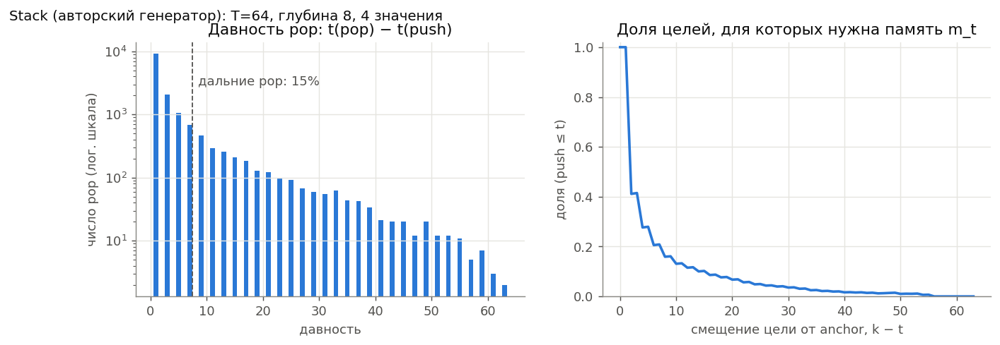
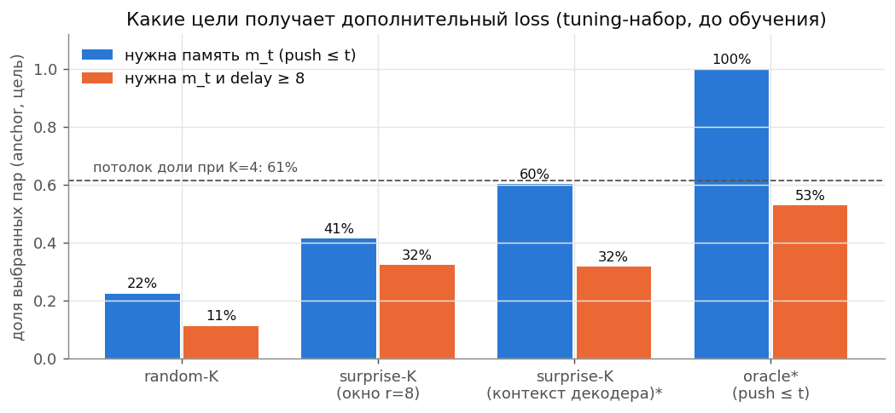
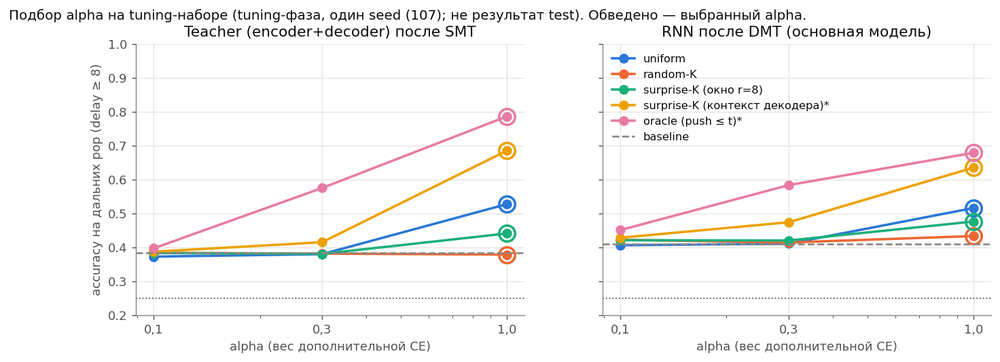
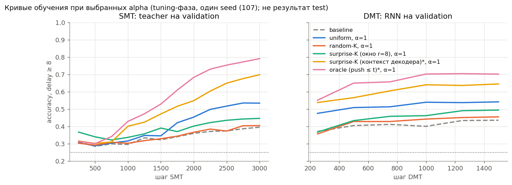
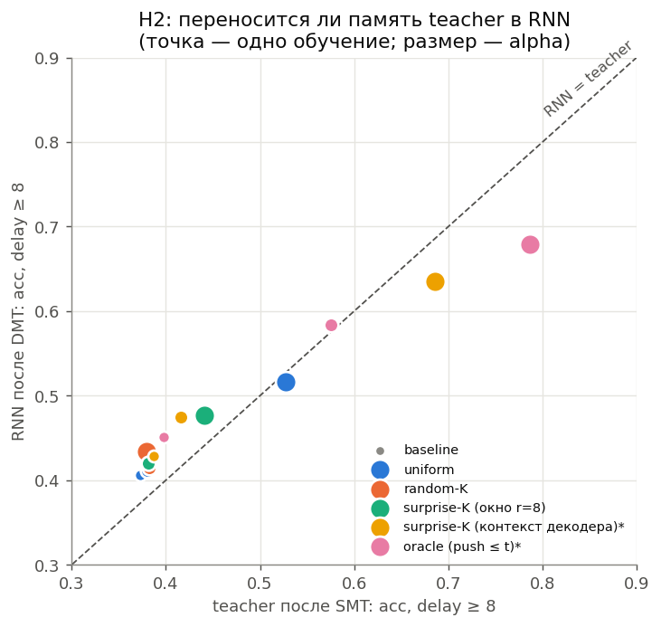
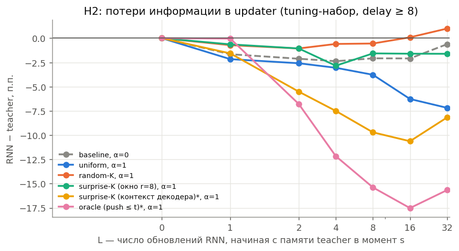

# Результаты для обсуждения (собрано из `stack02_4c69a2819ab8`)

Все числа ниже — **данные, аудит отбора, baseline и подбор alpha** на tuning-seed 107. Это не финальное сравнение: оно будет по трём seeds (7, 17, 27) на отдельном test по правилу из `preregistration.md`. Checkpoint выбирался по validation, alpha — по tuning-набору. Варианты со звёздочкой — вторичная диагностика (oracle использует metadata генератора). «Дальние pop» — pop с delay ≥ 8 (в Stack давность нечётная, т.е. ≥ 9); случайный уровень 25%.

## 1. Данные

Слева: большинство pop короткие, дальних около 15%. Справа: цель на смещении 0 (ответ RNN) всегда требует памяти; дальше по будущему растёт доля целей, чей элемент положен уже после anchor — их decoder видит во входах и без m_t.

| split | sequences | pops | long_pops | long_fraction | ge16_fraction | delay_median | delay_p95 | unique_sequences |
|---|---|---|---|---|---|---|---|---|
| validation | 512 | 15344 | 2275 | 0.148 | 0.068 | 1.000 | 19.000 | 512 |
| tuning | 512 | 15377 | 2359 | 0.153 | 0.074 | 1.000 | 21.000 | 512 |

## 2. Аудит отбора целей (до обучения SMT)

Окно r=8 отделяет цели «вне окна» идеально (AUC 1.000), но 59% выбранных им пар имеют источник после anchor. Score по входам декодера (без памяти) почти достигает потолка доли memory-dependent целей.

| rule | pairs | memory_dependent | long_memory_dependent | future_source | mean_delay |
|---|---|---|---|---|---|
| random_k | 123169 | 0.223 | 0.111 | 0.777 | 5.523 |
| surprise_k | 123169 | 0.413 | 0.323 | 0.587 | 14.303 |
| surprise_ctx_k | 123169 | 0.602 | 0.317 | 0.398 | 12.872 |
| oracle_prefix_k | 75590 | 1.000 | 0.527 | 0.000 | 14.435 |
| random_k (exact expectation) | 123169 | 0.224 | 0.112 | 0.776 | nan |

## 3. Baseline

Gate на tuning-наборе пройден: teacher 38.3%, RNN после DMT 41.0% на дальних pop (пороги 35% / 30%). Pop с delay ≤ 8 решены почти полностью; узкое место — дальние.

## 4. Подбор alpha (одинаковая сетка и бюджет для всех вариантов)

| вариант | alpha | выбран | teacher: acc дальн. | teacher: CE дальн. | RNN до DMT: acc | RNN после DMT: acc | RNN после DMT: CE | RNN после DMT, голова teacher: acc | RNN после DMT: acc все pop |
|---|---|---|---|---|---|---|---|---|---|
| baseline | 0.000 | ✓ | 0.383 | 1.294 | 0.348 | 0.410 | 1.239 | 0.363 | 0.909 |
| uniform | 0.100 |  | 0.373 | 1.295 | 0.343 | 0.407 | 1.236 | 0.359 | 0.909 |
| uniform | 0.300 |  | 0.380 | 1.282 | 0.343 | 0.411 | 1.236 | 0.368 | 0.910 |
| uniform | 1.000 | ✓ | 0.528 | 1.029 | 0.361 | 0.516 | 1.031 | 0.461 | 0.926 |
| random-K | 0.100 |  | 0.384 | 1.277 | 0.339 | 0.423 | 1.225 | 0.369 | 0.911 |
| random-K | 0.300 |  | 0.382 | 1.283 | 0.346 | 0.415 | 1.226 | 0.365 | 0.910 |
| random-K | 1.000 | ✓ | 0.379 | 1.281 | 0.345 | 0.434 | 1.207 | 0.386 | 0.913 |
| surprise-K (окно r=8) | 0.100 |  | 0.384 | 1.296 | 0.307 | 0.421 | 1.230 | 0.378 | 0.911 |
| surprise-K (окно r=8) | 0.300 |  | 0.381 | 1.280 | 0.322 | 0.421 | 1.203 | 0.379 | 0.898 |
| surprise-K (окно r=8) | 1.000 | ✓ | 0.441 | 1.207 | 0.333 | 0.476 | 1.128 | 0.430 | 0.900 |
| surprise-K (контекст декодера)* | 0.100 |  | 0.387 | 1.276 | 0.304 | 0.429 | 1.206 | 0.380 | 0.912 |
| surprise-K (контекст декодера)* | 0.300 |  | 0.415 | 1.217 | 0.349 | 0.474 | 1.133 | 0.420 | 0.919 |
| surprise-K (контекст декодера)* | 1.000 | ✓ | 0.685 | 0.693 | 0.411 | 0.635 | 0.823 | 0.575 | 0.941 |
| oracle (push ≤ t)* | 0.100 |  | 0.397 | 1.256 | 0.331 | 0.451 | 1.174 | 0.413 | 0.915 |
| oracle (push ≤ t)* | 0.300 |  | 0.575 | 0.938 | 0.310 | 0.584 | 0.945 | 0.490 | 0.933 |
| oracle (push ≤ t)* | 1.000 | ✓ | 0.786 | 0.486 | 0.461 | 0.679 | 0.703 | 0.609 | 0.948 |

Зафиксированные alpha: `{"baseline": 0.0, "oracle_prefix_k": 1.0, "random_k": 1.0, "surprise_ctx_k": 1.0, "surprise_k": 1.0, "uniform": 1.0}`

### Что видно на tuning (предварительно, один seed, не test)

* baseline, α=0: teacher 38.3%, RNN после DMT 41.0% (CE 1.239)
* uniform, α=1: teacher 52.8%, RNN после DMT 51.6% (CE 1.031)
* random-K, α=1: teacher 37.9%, RNN после DMT 43.4% (CE 1.207)
* surprise-K (окно r=8), α=1: teacher 44.1%, RNN после DMT 47.6% (CE 1.128)
* surprise-K (контекст декодера)*, α=1: teacher 68.5%, RNN после DMT 63.5% (CE 0.823)
* oracle (push ≤ t)*, α=1: teacher 78.6%, RNN после DMT 67.9% (CE 0.703)

* Согласованный surprise-K (окно r=8) на tuning лучше random-K, но хуже uniform. Варианты, где больше выбранных целей реально требуют памяти m_t (контекстный score, oracle), дают больший прирост. Проверка этого — финальные три seeds на test по правилу из `preregistration.md`.
* **Ограничение:** у всех вариантов выбран α=1,0 — край заранее заданной сетки; при большем α результат мог бы быть иным у всех вариантов. Сетка одинакова для всех и не менялась после просмотра.
* uniform — сильный контроль: при α=1 он меняет соотношение decoder : dynamics : uniformity в SMT loss (Adam почти не чувствителен к общему масштабу loss).

## 5. H2: перенос памяти teacher в RNN

Слева точки около диагонали — DMT переносит качество teacher в RNN. Справа: RNN стартует из памяти teacher в момент s и делает L шагов; ниже нуля — информация теряется в updater.

## Таблица: accuracy по давности (выбранные alpha, tuning-набор)

| variant | stage | model | 1–2 | 3–4 | 5–8 | 9–16 | 17+ |
|---|---|---|---|---|---|---|---|
| baseline | dmt | rnn | 1.000 | 1.000 | 1.000 | 0.465 | 0.350 |
| baseline | dmt | teacher | 1.000 | 1.000 | 0.990 | 0.434 | 0.328 |
| baseline | smt | rnn | 0.998 | 0.954 | 0.883 | 0.365 | 0.330 |
| baseline | smt | teacher | 1.000 | 1.000 | 0.990 | 0.434 | 0.328 |
| uniform | dmt | rnn | 1.000 | 1.000 | 1.000 | 0.610 | 0.415 |
| uniform | dmt | teacher | 1.000 | 0.999 | 0.989 | 0.583 | 0.468 |
| uniform | smt | rnn | 0.978 | 0.875 | 0.792 | 0.386 | 0.334 |
| uniform | smt | teacher | 1.000 | 0.999 | 0.989 | 0.583 | 0.468 |
| random_k | dmt | rnn | 1.000 | 1.000 | 0.999 | 0.496 | 0.366 |
| random_k | dmt | teacher | 1.000 | 1.000 | 0.988 | 0.430 | 0.323 |
| random_k | smt | rnn | 0.999 | 0.979 | 0.896 | 0.364 | 0.325 |
| random_k | smt | teacher | 1.000 | 1.000 | 0.988 | 0.430 | 0.323 |
| surprise_k | dmt | rnn | 1.000 | 0.977 | 0.850 | 0.572 | 0.373 |
| surprise_k | dmt | teacher | 1.000 | 0.995 | 0.909 | 0.524 | 0.352 |
| surprise_k | smt | rnn | 0.987 | 0.709 | 0.525 | 0.364 | 0.299 |
| surprise_k | smt | teacher | 1.000 | 0.995 | 0.909 | 0.524 | 0.352 |
| surprise_ctx_k | dmt | rnn | 1.000 | 1.000 | 0.976 | 0.764 | 0.496 |
| surprise_ctx_k | dmt | teacher | 1.000 | 0.995 | 0.975 | 0.825 | 0.534 |
| surprise_ctx_k | smt | rnn | 0.994 | 0.806 | 0.748 | 0.488 | 0.328 |
| surprise_ctx_k | smt | teacher | 1.000 | 0.995 | 0.975 | 0.825 | 0.534 |
| oracle_prefix_k | dmt | rnn | 1.000 | 1.000 | 0.972 | 0.809 | 0.538 |
| oracle_prefix_k | dmt | teacher | 1.000 | 0.992 | 0.981 | 0.933 | 0.627 |
| oracle_prefix_k | smt | rnn | 0.969 | 0.918 | 0.699 | 0.558 | 0.355 |
| oracle_prefix_k | smt | teacher | 1.000 | 0.992 | 0.981 | 0.933 | 0.627 |

## Файлы

* `table_*.csv` — все таблицы; `table_validation_histories.csv` — validation по шагам для всех обучений.
* `locked_alphas.json` — зафиксированные alpha. `preregistration.md` — правило вывода, записанное до подбора alpha.
* Окно r=8, K=4, размеры моделей, шаги, seeds, пороги gate — наши настройки, научником не фиксировались.
