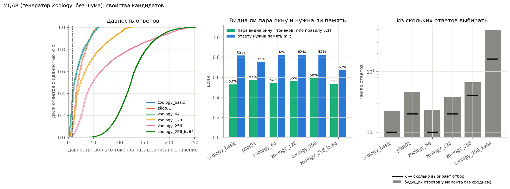
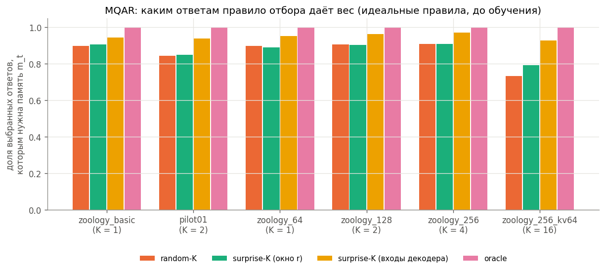
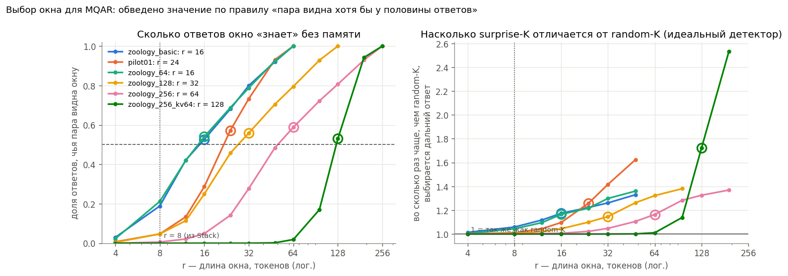
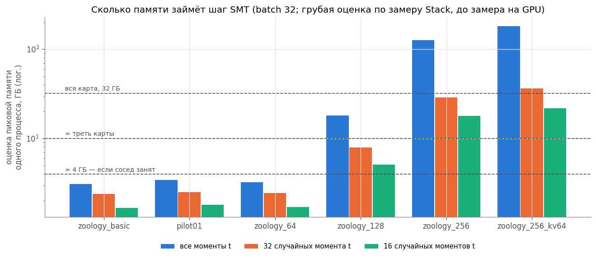

# MQAR (Zoology, без шума): данные, отбор ответов и стоимость — до обучения

Ничего не обучалось. Это подготовка эксперимента: свойства кандидатов-конфигураций, каким ответам дополнительный
loss даст вес (идеальные правила отбора), и оценка памяти/времени. Код: `smt_memup_mqar.py`, ноутбук `03_smt_memup_mqar.ipynb`.

## Как читать
* **MQAR**: сначала N пар «ключ значение», потом N запросов по ключам; на запросе модель называет значение. Генератор —
  `zoology.data.multiquery_ar` (commit 1ad20d1), `random_non_queries=False`.
* **Давность ответа** — сколько токенов назад записано значение. **Нужна память m_t** — значение записано не позже
  момента t, поэтому декодер может получить его только из памяти.
* **K** — сколько будущих ответов выбирает отбор у каждого момента t; у нас K = N/4.
* Правила отбора: random-K (случайные), surprise-K с окном r токенов (основной вариант; r — по правилу ниже), surprise-K по входам
  декодера (доп.), oracle по разметке (доп.). Здесь они **идеальные** — верхняя граница для обученных детекторов.

## Пример последовательности (zoology_basic, без заполнителей)
| t | токен | роль | ответ | значение_записано_на | давность |
|---|---|---|---|---|---|
| 0 | 127 | ключ |  |  |  |
| 1 | 208 | значение |  |  |  |
| 2 | 108 | ключ |  |  |  |
| 3 | 172 | значение |  |  |  |
| 4 | 33 | ключ |  |  |  |
| 5 | 131 | значение |  |  |  |
| 6 | 46 | ключ |  |  |  |
| 7 | 151 | значение |  |  |  |
| 8 | 33 | запрос | 131 | 5 | 3 |
| 10 | 46 | запрос | 151 | 7 | 3 |
| 18 | 127 | запрос | 208 | 1 | 17 |
| 40 | 108 | запрос | 172 | 3 | 37 |

## 1. Кандидаты и их свойства

| конфигурация | словарь | длина | пар | K | delay_median | long_fraction | pair_inside_last_r_tokens | mean_pool | anchors_pool_gt_K | chance_structured |
|---|---|---|---|---|---|---|---|---|---|---|
| zoology_basic | 256 | 64 | 4 | 1 | 13.000 | 0.431 | 0.526 | 2.240 | 0.610 | 0.250 |
| pilot01 | 128 | 64 | 8 | 2 | 19.000 | 0.382 | 0.572 | 4.600 | 0.679 | 0.125 |
| zoology_64 | 8192 | 64 | 4 | 1 | 13.000 | 0.420 | 0.540 | 2.291 | 0.635 | 0.250 |
| zoology_128 | 8192 | 128 | 8 | 2 | 25.000 | 0.411 | 0.559 | 3.775 | 0.573 | 0.125 |
| zoology_256 | 8192 | 256 | 16 | 4 | 49.000 | 0.404 | 0.588 | 6.666 | 0.533 | 0.062 |
| zoology_256_kv64 | 8192 | 256 | 64 | 16 | 123.000 | 0.440 | 0.530 | 48.188 | 0.875 | 0.016 |

## 2. Каким ответам отбор даёт вес

| конфигурация | random-K | surprise-K (окно r) | surprise-K (входы декодера) | oracle |
|---|---|---|---|---|
| zoology_basic | 0.897 | 0.907 | 0.944 | 1.000 |
| pilot01 | 0.844 | 0.849 | 0.937 | 1.000 |
| zoology_64 | 0.897 | 0.891 | 0.951 | 1.000 |
| zoology_128 | 0.905 | 0.903 | 0.963 | 1.000 |
| zoology_256 | 0.909 | 0.909 | 0.970 | 1.000 |
| zoology_256_kv64 | 0.733 | 0.792 | 0.928 | 1.000 |

## 2.1. Окно локального детектора: откуда число

Число 8 научник не задавал: оно пришло из ноутбука 01, где было выбрано для Stack. На MQAR при r = 8 пара ключ–значение
почти никогда не видна окну, и даже идеальный surprise-K выбирает как random-K. Поэтому для MQAR r задаётся правилом по
данным, до обучения: **наименьшее r из сетки, при котором пара видна окну хотя бы у половины ответов**; «дальний ответ» —
давность ≥ r. Получается r = 16 (basic, 64/4), 24 (pilot01), 32 (128/8), 64 (256/16), 128 (256/64).

**Главное:** на MQAR почти всем ответам нужна память, поэтому отбор может различать в основном давние и недавние ответы.
Даже идеальный детектор с окном по правилу обогащает дальние ответы лишь в 1,1–1,3 раза (в Stack было ×2,9). MQAR слабее
проверяет гипотезу об отборе, чем Stack; стоит обсудить с научником до дорогих запусков.

## 3. Влезет ли

| конфигурация | моменты_t | оценка_пик_ГБ | DMT | обучений | часов_на_обучение | часов_всего | процессов_в_32_ГБ | SMT_последовательностей | часов_при_параллели |
|---|---|---|---|---|---|---|---|---|---|
| zoology_basic | все | 3.100 | вся последовательность | 34 | 0.250 | 8.600 | 3 | 96000 | 2.900 |
| zoology_basic | 32 | 2.400 | вся последовательность | 34 | 0.250 | 8.500 | 3 | 96000 | 2.800 |
| zoology_basic | 16 | 1.700 | вся последовательность | 34 | 0.250 | 8.500 | 3 | 96000 | 2.800 |
| pilot01 | все | 3.400 | вся последовательность | 34 | 0.260 | 8.700 | 3 | 96000 | 2.900 |
| pilot01 | 32 | 2.500 | вся последовательность | 34 | 0.250 | 8.500 | 3 | 96000 | 2.800 |
| pilot01 | 16 | 1.800 | вся последовательность | 34 | 0.250 | 8.500 | 3 | 96000 | 2.800 |
| zoology_64 | все | 3.200 | вся последовательность | 34 | 0.250 | 8.500 | 3 | 96000 | 2.800 |
| zoology_64 | 32 | 2.400 | вся последовательность | 34 | 0.250 | 8.500 | 3 | 96000 | 2.800 |
| zoology_64 | 16 | 1.700 | вся последовательность | 34 | 0.250 | 8.500 | 3 | 96000 | 2.800 |
| zoology_128 | все | 18.200 | отрезки по 64 шага | 34 | 0.420 | 14.400 | 1 | 96000 | 14.400 |
| zoology_128 | 32 | 7.900 | отрезки по 64 шага | 34 | 0.320 | 10.800 | 3 | 96000 | 3.600 |
| zoology_128 | 16 | 5.100 | отрезки по 64 шага | 34 | 0.290 | 9.800 | 3 | 96000 | 3.300 |
| zoology_256 | 32 | 28.800 | отрезки по 64 шага | 34 | 0.610 | 20.800 | 1 | 96000 | 20.800 |
| zoology_256 | 16 | 17.900 | отрезки по 64 шага | 34 | 0.490 | 16.800 | 1 | 96000 | 16.800 |
| zoology_256_kv64 | 16 | 21.800 | отрезки по 64 шага | 34 | 0.510 | 17.500 | 1 | 96000 | 17.500 |

Оценки — масштабирование измеренного шага Stack (0,10 с; 7,7 ГБ), не замер. «моменты_t = 32» — 32 случайных момента t
на последовательность вместо всех (Monte Carlo-оценка того же loss). Для длины ≥ 128 DMT — отрезки по 64 шага от
состояния teacher, как у авторов SMT. Таблица `table_cost_estimates.csv` — все варианты, включая batch 16.

## Что нужно решить
1. Конфигурация. Длина 64 влезает со всеми моментами t; 128 — с подвыборкой; 256 со словарём 8192 — только с сильной
   подвыборкой, по оценке больше трети карты.
2. Разрешить замер на GPU (раздел 6.1 ноутбука; ~2–5 мин, лимит памяти процесса).
3. Обсудить с научником, что на MQAR согласованный surprise-K почти совпадает с random-K по построению.
