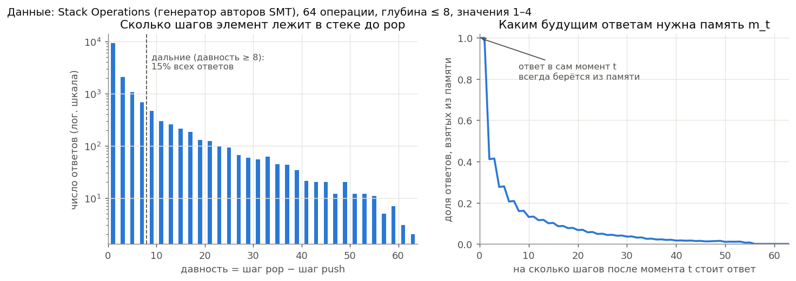
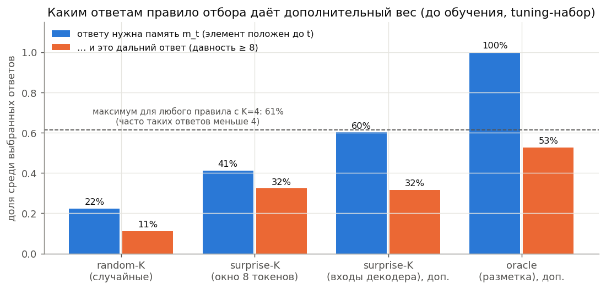
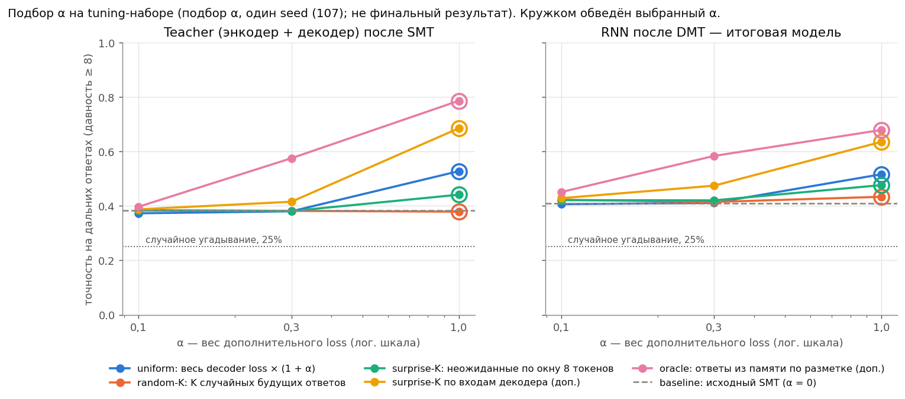
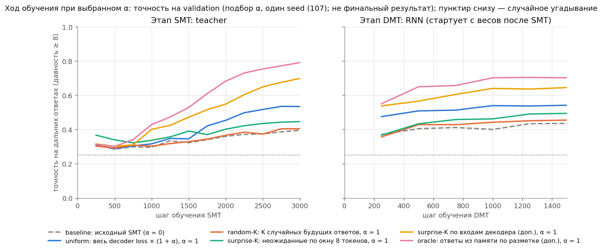
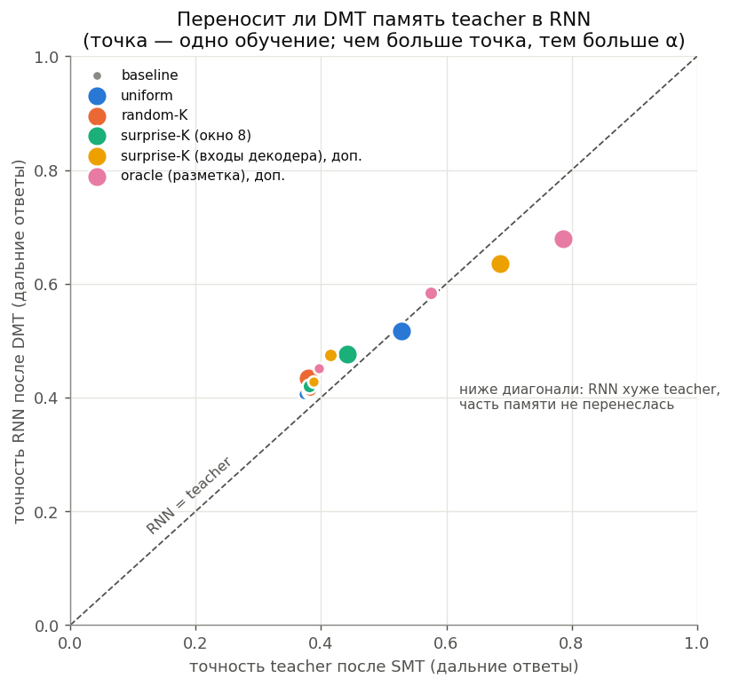
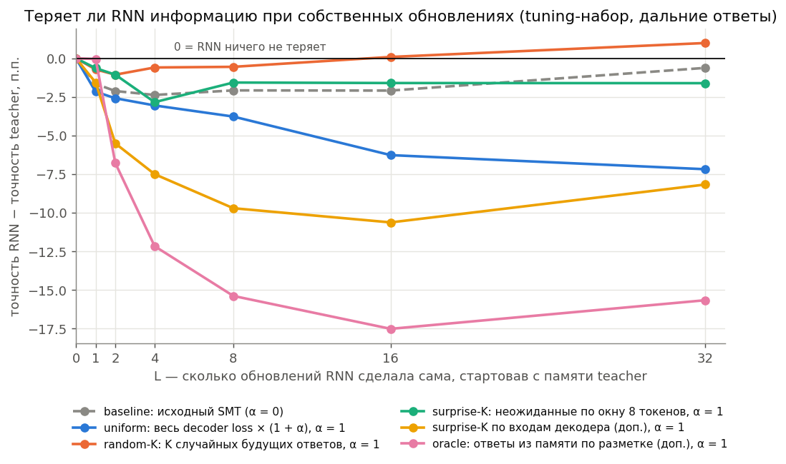

# Stack Operations: данные, отбор ответов, baseline и подбор α (версия 2 графиков)

Это **не финальное сравнение**: все обучения ниже — на одном seed (107) при подборе α. Финал — три seeds (7, 17, 27) на отдельном test по правилу из `preregistration.md`. Checkpoint выбирался по validation, α — по отдельному tuning-набору (512 последовательностей). Источник: `stack02_4c69a2819ab8`.

## Как читать
* **Задача** — Stack Operations без шума, генератор авторов SMT (`StackDataset`): последовательность из 64 операций
  push(значение 1–4) и pop; после каждого pop модель должна назвать извлечённое значение. Глубина стека ≤ 8.
  **MQAR в этой версии ещё не обучался** (был только в архивном пилоте 01).
* **Ответ** — значение, которое нужно назвать на pop. **Давность** — сколько шагов элемент пролежал в стеке
  (шаг pop − шаг push). **Дальний ответ** — давность ≥ 8 (в Stack давность всегда нечётная, т.е. ≥ 9).
  Случайное угадывание — 25%.
* **Teacher** — энкодер-трансформер, сжимающий прошлое в память m_t, + декодер, предсказывающий будущие ответы.
  **RNN** — рекуррентная модель, обновляющая m_t шаг за шагом. **SMT** учит teacher и RNN (RNN — одношаговым
  переходам), **DMT** доучивает RNN на собственных траекториях. Итоговая модель — RNN после DMT.
* **Дополнительный loss** (MemUP-идея): в каждый момент t выбираем K=4 будущих ответа и даём им вес α поверх
  исходного SMT loss. Варианты отличаются правилом выбора:
  baseline — без добавки; uniform — добавка на все ответы; random-K — K случайных;
  **surprise-K** — K самых неожиданных для маленькой модели, видящей только 8 последних токенов (основной вариант);
  surprise-K по входам декодера — неожиданность при виде только тех входов, что видит декодер (доп.);
  oracle — K случайных среди ответов, которым по разметке генератора нужна память m_t (доп., подсмотр разметки).
* «Ответу нужна память m_t» — элемент положен в стек не позже момента t, поэтому декодер может взять его только
  из памяти. Иначе элемент появится во входах декодера после t, и память не нужна.

## 1. Данные

Слева: большинство элементов извлекаются почти сразу; дальних ответов около 15%. Справа: чем дальше в будущем ответ, тем чаще его элемент положен уже после t — тогда декодер видит его во входах и память не нужна. Поэтому «неожиданный» ответ не обязательно учит память.

| набор | последовательностей | ответов (pop) | дальних ответов | доля дальних | доля с давностью ≥ 16 | медиана давности | 95-й перцентиль давности | уникальных |
|---|---|---|---|---|---|---|---|---|
| validation | 512 | 15344 | 2275 | 0.148 | 0.068 | 1.000 | 19.000 | 512 |
| tuning | 512 | 15377 | 2359 | 0.153 | 0.074 | 1.000 | 21.000 | 512 |

## 2. Каким ответам дополнительный loss даёт вес (до обучения)

Модель с окном 8 токенов идеально находит ответы, чей элемент старше окна (AUC 1.000), но 59% выбранных ею ответов не требуют памяти m_t: их элемент положен после t. Правило по входам декодера почти достигает максимума доли ответов из памяти.

| правило | выбрано пар | нужна память m_t | нужна память и дальний | элемент положен после t | средняя давность |
|---|---|---|---|---|---|
| random_k | 123169 | 0.223 | 0.111 | 0.777 | 5.523 |
| surprise_k | 123169 | 0.413 | 0.323 | 0.587 | 14.303 |
| surprise_ctx_k | 123169 | 0.602 | 0.317 | 0.398 | 12.872 |
| oracle_prefix_k | 75590 | 1.000 | 0.527 | 0.000 | 14.435 |
| random_k (exact expectation) | 123169 | 0.224 | 0.112 | 0.776 | nan |

## 3. Baseline

Проверка работоспособности пройдена: на дальних ответах teacher 38.3%, RNN после DMT 41.0% (пороги 35% / 30%, случайное — 25%). Ответы с давностью < 8 решены почти полностью.

## 4. Подбор α (одинаковые сетка и бюджет у всех вариантов)

| вариант | α | выбран | teacher после SMT: точность | teacher после SMT: CE | RNN до DMT: точность | RNN после DMT: точность | RNN после DMT: CE | RNN после DMT через голову teacher: точность | RNN после DMT: точность на всех ответах |
|---|---|---|---|---|---|---|---|---|---|
| baseline | 0.000 | ✓ | 0.383 | 1.294 | 0.348 | 0.410 | 1.239 | 0.363 | 0.909 |
| uniform | 0.100 |  | 0.373 | 1.295 | 0.343 | 0.407 | 1.236 | 0.359 | 0.909 |
| uniform | 0.300 |  | 0.380 | 1.282 | 0.343 | 0.411 | 1.236 | 0.368 | 0.910 |
| uniform | 1.000 | ✓ | 0.528 | 1.029 | 0.361 | 0.516 | 1.031 | 0.461 | 0.926 |
| random-K | 0.100 |  | 0.384 | 1.277 | 0.339 | 0.423 | 1.225 | 0.369 | 0.911 |
| random-K | 0.300 |  | 0.382 | 1.283 | 0.346 | 0.415 | 1.226 | 0.365 | 0.910 |
| random-K | 1.000 | ✓ | 0.379 | 1.281 | 0.345 | 0.434 | 1.207 | 0.386 | 0.913 |
| surprise-K (окно 8) | 0.100 |  | 0.384 | 1.296 | 0.307 | 0.421 | 1.230 | 0.378 | 0.911 |
| surprise-K (окно 8) | 0.300 |  | 0.381 | 1.280 | 0.322 | 0.421 | 1.203 | 0.379 | 0.898 |
| surprise-K (окно 8) | 1.000 | ✓ | 0.441 | 1.207 | 0.333 | 0.476 | 1.128 | 0.430 | 0.900 |
| surprise-K (входы декодера), доп. | 0.100 |  | 0.387 | 1.276 | 0.304 | 0.429 | 1.206 | 0.380 | 0.912 |
| surprise-K (входы декодера), доп. | 0.300 |  | 0.415 | 1.217 | 0.349 | 0.474 | 1.133 | 0.420 | 0.919 |
| surprise-K (входы декодера), доп. | 1.000 | ✓ | 0.685 | 0.693 | 0.411 | 0.635 | 0.823 | 0.575 | 0.941 |
| oracle (разметка), доп. | 0.100 |  | 0.397 | 1.256 | 0.331 | 0.451 | 1.174 | 0.413 | 0.915 |
| oracle (разметка), доп. | 0.300 |  | 0.575 | 0.938 | 0.310 | 0.584 | 0.945 | 0.490 | 0.933 |
| oracle (разметка), доп. | 1.000 | ✓ | 0.786 | 0.486 | 0.461 | 0.679 | 0.703 | 0.609 | 0.948 |

### Что видно (предварительно: один seed, не test)

* baseline, α = 0: teacher 38.3%, RNN после DMT 41.0% (CE 1.239)
* uniform, α = 1: teacher 52.8%, RNN после DMT 51.6% (CE 1.031)
* random-K, α = 1: teacher 37.9%, RNN после DMT 43.4% (CE 1.207)
* surprise-K (окно 8), α = 1: teacher 44.1%, RNN после DMT 47.6% (CE 1.128)
* surprise-K (входы декодера), доп., α = 1: teacher 68.5%, RNN после DMT 63.5% (CE 0.823)
* oracle (разметка), доп., α = 1: teacher 78.6%, RNN после DMT 67.9% (CE 0.703)

* Основной surprise-K (окно 8 токенов) лучше random-K, но хуже uniform. Правила, у которых больше выбранных ответов действительно берутся из памяти m_t (по входам декодера, oracle), дают больший прирост. Проверка — три финальных seeds на test.
* **Ограничение:** у всех вариантов выбран α = 1,0 — край заранее заданной сетки.
* uniform — сильный контроль: при α = 1 он меняет соотношение слагаемых SMT loss (decoder : dynamics : uniformity); Adam почти не чувствителен к общему масштабу loss.

## 5. Переносится ли память teacher в RNN (вопрос научника про последовательные обновления)

Слева: при слабой памяти teacher точки на диагонали или выше — RNN ничего не теряет (выше — за счёт дообученной головы RNN). При сильной памяти (oracle, входы декодера) точки ниже диагонали. Справа то же напрямую: RNN, стартовав с памяти teacher, за 8–16 своих шагов теряет до 15–17 п.п. у этих вариантов.

## Точность по давности (выбранные α, tuning-набор)

| вариант | модель | давность 1–2 | давность 3–4 | давность 5–8 | давность 9–16 | давность 17+ |
|---|---|---|---|---|---|---|
| baseline, α = 0 | RNN после DMT | 1.000 | 1.000 | 1.000 | 0.465 | 0.350 |
| baseline, α = 0 | RNN до DMT | 0.998 | 0.954 | 0.883 | 0.365 | 0.330 |
| baseline, α = 0 | teacher после SMT | 1.000 | 1.000 | 0.990 | 0.434 | 0.328 |
| uniform, α = 1 | RNN после DMT | 1.000 | 1.000 | 1.000 | 0.610 | 0.415 |
| uniform, α = 1 | RNN до DMT | 0.978 | 0.875 | 0.792 | 0.386 | 0.334 |
| uniform, α = 1 | teacher после SMT | 1.000 | 0.999 | 0.989 | 0.583 | 0.468 |
| random-K, α = 1 | RNN после DMT | 1.000 | 1.000 | 0.999 | 0.496 | 0.366 |
| random-K, α = 1 | RNN до DMT | 0.999 | 0.979 | 0.896 | 0.364 | 0.325 |
| random-K, α = 1 | teacher после SMT | 1.000 | 1.000 | 0.988 | 0.430 | 0.323 |
| surprise-K (окно 8), α = 1 | RNN после DMT | 1.000 | 0.977 | 0.850 | 0.572 | 0.373 |
| surprise-K (окно 8), α = 1 | RNN до DMT | 0.987 | 0.709 | 0.525 | 0.364 | 0.299 |
| surprise-K (окно 8), α = 1 | teacher после SMT | 1.000 | 0.995 | 0.909 | 0.524 | 0.352 |
| surprise-K (входы декодера), доп., α = 1 | RNN после DMT | 1.000 | 1.000 | 0.976 | 0.764 | 0.496 |
| surprise-K (входы декодера), доп., α = 1 | RNN до DMT | 0.994 | 0.806 | 0.748 | 0.488 | 0.328 |
| surprise-K (входы декодера), доп., α = 1 | teacher после SMT | 1.000 | 0.995 | 0.975 | 0.825 | 0.534 |
| oracle (разметка), доп., α = 1 | RNN после DMT | 1.000 | 1.000 | 0.972 | 0.809 | 0.538 |
| oracle (разметка), доп., α = 1 | RNN до DMT | 0.969 | 0.918 | 0.699 | 0.558 | 0.355 |
| oracle (разметка), доп., α = 1 | teacher после SMT | 1.000 | 0.992 | 0.981 | 0.933 | 0.627 |

## Файлы

* `table_*.csv` — все таблицы; `table_validation_histories.csv` — validation по шагам для всех обучений.
* `locked_alphas.json` — выбранные α. `preregistration.md` — правило вывода, записанное до подбора α.
* Окно 8 токенов, K = 4, размеры моделей, число шагов, seeds и пороги — наши настройки, научник их не фиксировал.
