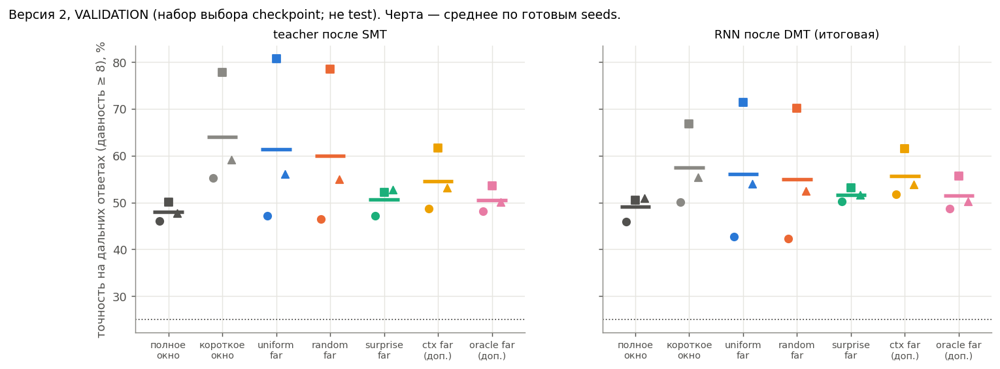

# Версия 2 (Stack): короткое окно SMT + MemUP-supervision дальних целей — промежуточно

**Только validation (набор выбора checkpoint), не test.** Обучения идут; таблица обновляется командой
`python make_v2_outputs.py --validation`. Значения взяты из лучшего checkpoint по validation CE, как в протоколе;
поэтому они могут немного отличаться от последней строки лога. Протокол и правило вывода — `proposals/preregistration_v2.md`.
Test — один раз после всех 18 обучений, с разрешения пользователя.

## Итоговая RNN (после DMT), точность на дальних ответах, % (validation) — все 18 обучений
Обновлено 14.10.2026, 20:45. Значения — лучший checkpoint по validation CE.

| вариант | seed 7 | seed 17 | seed 27 | среднее |
|---|---|---|---|---|
| полное окно (версия 1, baseline; ориентир) | 45,9 | 50,5 | 50,9 | 49,1 |
| **короткое окно (Tf = 8), без добавки** | 50,1 | 66,7 | 55,4 | **57,4** |
| + все дальние цели (uniform_far) | 42,7 | 71,4 | 53,9 | 56,0 |
| + 2 случайные дальние (random_far) | 42,3 | 70,1 | 52,4 | 54,9 |
| **+ 2 неожиданные дальние, окно 8 (surprise_far)** | 50,2 | 53,2 | 51,6 | 51,7 |
| + 2 неожиданные по входам декодера (ctx_far, доп.) | 51,7 | 61,5 | 53,9 | 55,7 |
| + 2 дальние из памяти (oracle_far, доп.) | 48,7 | 55,7 | 50,2 | 51,5 |

Парные разности итоговой RNN по seeds 7 / 17 / 27 (validation):

| сравнение | точность, п.п. | CE |
|---|---|---|
| surprise_far − random_far | +7,9 / −16,9 / −0,8 | −0,134 / +0,344 / +0,042 |
| random_far − base_window | −7,8 / +3,4 / −3,0 | |
| base_window − полное окно | +4,2 / +16,2 / +4,5 | −0,080 / −0,301 / −0,113 |

**Механизм — хранит ли промежуточная память teacher элемент для дальнего ответа** (`far_probe`: дальние пары с push ≤ t,
декодер из m_t; validation):

| вариант | seed 7 | seed 17 | seed 27 |
|---|---|---|---|
| короткое окно, без добавки | 33,1 | 33,9 | 34,9 |
| uniform_far | 42,3 | 57,8 | 44,9 |
| random_far | 42,2 | 55,0 | 44,1 |
| surprise_far | 47,1 | 44,9 | 50,4 |
| ctx_far | 57,9 | 67,5 | 61,2 |
| oracle_far | 71,2 | 76,1 | 70,4 |

## Что видно (validation; окончательно решит test)
* **Короткое окно само по себе лучше полного на всех трёх seeds** (+4…+16 п.п.).
* **Механизм дальней supervision работает.** Выбранные дальние цели заставляют промежуточную память teacher дольше держать
  нужные элементы: без добавки ~34%, со случайными целями 42–55%, при отборе по входам декодера 58–68%, у oracle 70–76%.
  Чем точнее отбор выделяет ответы, которым нужна память, тем сильнее эффект.
* **Но это не превращается в лучшую итоговую RNN** при бюджете 3000 / 1500 шагов. Главное сравнение surprise_far − random_far
  меняет знак по seeds (+7,9 / −16,9 / −0,8). По правилу предрегистрации эффект отбора здесь поддержан не будет.
* **Вероятная причина — недообученный режим.** Навык дальних ответов у teacher «включается» скачком, и не все прогоны
  успевают; дальние цели отнимают часть сигнала у основного окна. Проверка сходимости C1 показала, что при достаточном
  обучении teacher решает задачу полностью (`outputs_convergence/README.md`). Значит, отбор нужно сравнивать в сходящемся
  режиме.

Файлы: `table_validation_by_seed.csv` (teacher, RNN, CE, far-memory probe), `figV2_validation.png`.
