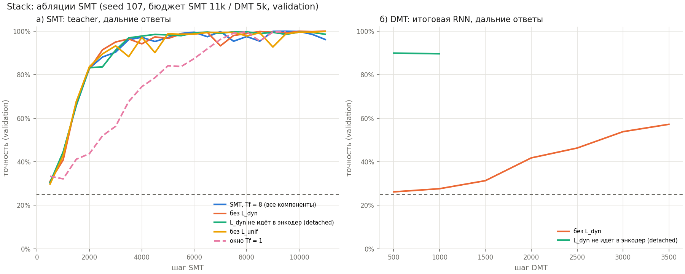

# 19.10.2026: абляции SMT на Stack и свип длины MQAR (validation / tuning, seed 107)

Собирает `python make_ablation_outputs.py`. Полные кривые — `tensorboard --logdir tensorboard`.

## Stack: абляции (бюджет SMT 11k / DMT 5k)

| what | smt_steps_done | teacher | teacher_to_80 | teacher_to_95 | rnn_before_dmt | far_probe | rnn_after_dmt | dmt_steps_done |
|---|---|---|---|---|---|---|---|---|
| SMT, Tf = 8 (все компоненты) | 11000 | 99.9% | 2000 | 3500 | 59.7% | 43.9% | — | 0 |
| без L_dyn | 11000 | 100.0% | 2000 | 3500 | 24.4% | 41.5% | 57.2% | 3500 |
| L_dyn не идёт в энкодер (detached) | 11000 | 99.7% | 2000 | 3500 | 62.9% | 44.4% | 89.6% | 1000 |
| без L_unif | 11000 | 99.8% | 2000 | 4000 | 78.5% | 42.9% | — | 0 |
| окно Tf = 1 | 9500 | 99.8% | 5000 | 7000 | 31.5% | 26.9% | — | 0 |

## MQAR: длина примера (вся последовательность в окне энкодера-декодера, Tc = Tf = T)
| T | pairs | model | long_acc | long_cand_acc | all_cand_acc | steps |
|---|---|---|---|---|---|---|
| 16 | 2 | SMT teacher | 50.8% | 50.8% | 52.8% | 6000 |
| 16 | 2 | Transformer (causal) | 98.9% | 99.3% | 98.9% | 500 |
| 16 | 2 | RNN, full BPTT | 53.9% | 53.9% | 53.1% | 6000 |
| 32 | 2 | SMT teacher | 49.3% | 49.3% | 50.9% | 6000 |
| 32 | 2 | Transformer (causal) | 99.8% | 99.8% | 99.9% | 500 |
| 32 | 2 | RNN, full BPTT | 51.1% | 54.7% | 51.9% | 6000 |
| 32 | 4 | SMT teacher | 24.8% | 24.8% | 24.9% | 6000 |
| 32 | 4 | Transformer (causal) | 99.7% | 99.7% | 99.6% | 500 |
| 32 | 4 | RNN, full BPTT | 0.7% | 25.6% | 25.0% | 6000 |

Угадывание среди записанных значений = 1/N.
