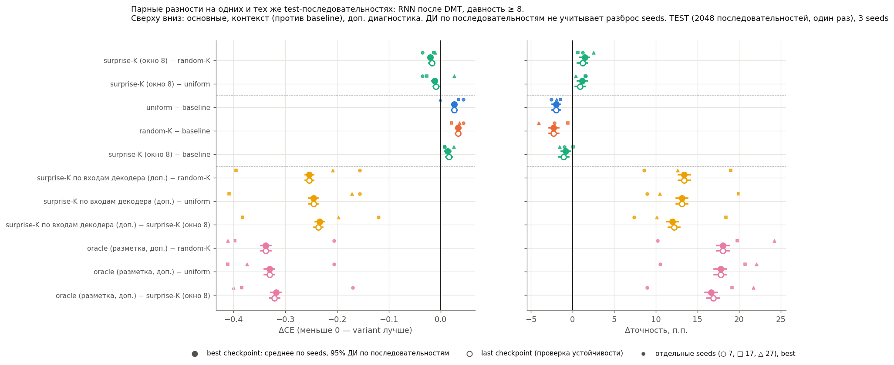
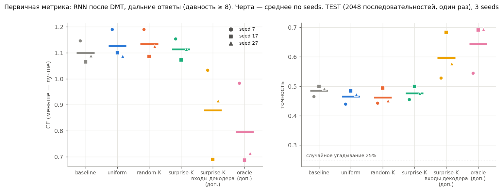
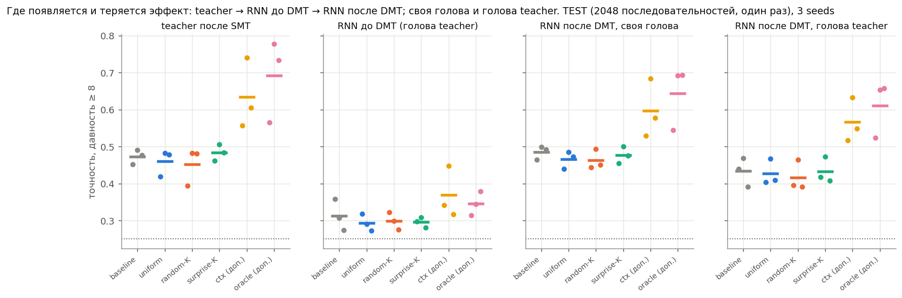
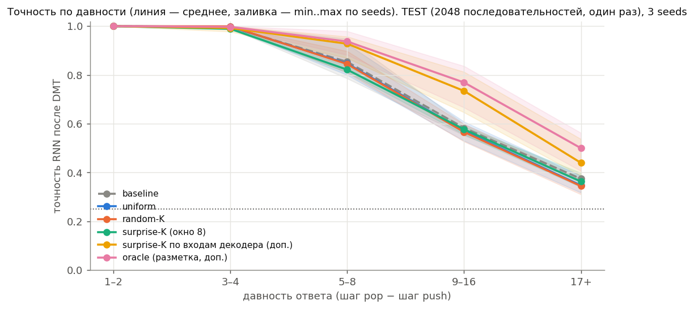
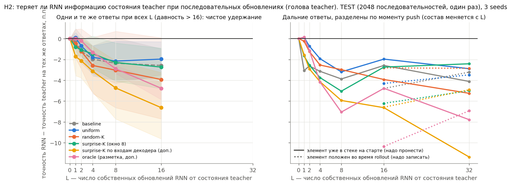

# Версия 1 (Stack, без шума): отчёт по TEST

**TEST, одна оценка, 14.10.2026.** Модели:
* 18 финальных обучений — 6 вариантов × seeds 7 / 17 / 27, checkpoints выбраны по validation;
* α и протокол зафиксированы до создания test.

Предрегистрация: `runs/stack02_4c69a2819ab8/preregistration.md`. Постановка: `proposals/setup_summary_v1.md`.

Test-набор:
* 2048 последовательностей, ≈ 61 тыс. ответов;
* 9116 дальних ответов (давность ≥ 8), из них 4269 с давностью ≥ 16;
* хэш набора — `test_report.json`;
* с validation и tuning не пересекается (проверено).

Все рисунки и таблицы собирает `python make_test_outputs.py --h2`. На test ничего не выбиралось.

Обозначения:
* **дальний ответ** — давность ≥ 8; угадывание наугад — 25%;
* **итоговая модель** — RNN после DMT;
* **ΔCE < 0** — вариант лучше.

---

## 1. Основной результат: H1 в согласованной форме при этом бюджете не поддержана

**Правило вывода** (`table_test_decision_rule.csv`). Оно должно выполниться для **обоих** основных сравнений: итоговая RNN, дальние ответы, best checkpoint.

| сравнение | ΔCE (среднее) | 95% ДИ по последовательностям | ΔCE по seeds 7 / 17 / 27 | Δточность | правило |
|---|---|---|---|---|---|
| surprise-K − random-K | **−0,020** | [−0,026; −0,015] | −0,036 / −0,013 / −0,011 | +1,4 п.п. | ✓ все 4 пункта |
| surprise-K − uniform | **−0,012** | [−0,018; −0,007] | −0,036 / −0,027 / **+0,026** | +1,2 п.п. | ✗ пункт 2: seed 27 другого знака |

С last checkpoint картина та же: −0,017 и −0,009, второе сравнение не проходит по тому же пункту.

**Вывод по правилу:**
* surprise-K стабильно, но слабо лучше random-K;
* против uniform преимущество не устойчиво по seeds;
* **H1 при этом бюджете не поддержана**;
* это не общее опровержение гипотезы: см. ограничения.

**Контекст против baseline:**

| вариант − baseline | ΔCE | Δточность | знак у всех seeds |
|---|---|---|---|
| uniform | +0,025 | −2,0 п.п. | точность — да |
| random-K | +0,033 | −2,3 п.п. | да |
| surprise-K | +0,013 | −0,8 п.п. | CE — да |

Все три согласованных варианта перевзвешивания в полном окне **немного хуже исходного SMT**. Surprise-K теряет меньше всех.

## 2. По seeds (итоговая RNN, дальние ответы)

| вариант | точность 7 / 17 / 27, % | CE 7 / 17 / 27 |
|---|---|---|
| baseline | 46,5 / 49,9 / 49,1 | 1,146 / 1,065 / 1,089 |
| uniform | 43,9 / 48,5 / 47,2 | 1,190 / 1,099 / 1,087 |
| random-K | 44,3 / 49,4 / 45,1 | 1,190 / 1,086 / 1,125 |
| surprise-K | 45,5 / 50,0 / 47,6 | 1,154 / 1,072 / 1,113 |
| ctx (доп.) | 52,9 / 68,4 / 57,7 | 1,033 / 0,690 / 0,916 |
| oracle (доп.) | 54,5 / 69,2 / 69,3 | 0,984 / 0,688 / 0,713 |

## 3. Дополнительная диагностика: где эффект есть

**Surprise-K по входам декодера (ctx)** — неожиданность ответа при тех же входах, что видит декодер SMT, без памяти:
* против baseline: ΔCE −0,22, точность +11,1 п.п.;
* против random-K: −0,25 и +13,4 п.п.;
* против uniform: −0,25 и +13,1 п.п.;
* знак одинаков на всех seeds; оба типа интервалов, включая «seeds × последовательности», не содержат 0.

**Oracle** (K случайных ответов, чей элемент положен до t; подсматривает разметку):
* против baseline: −0,30 и +15,8 п.п.

Интерпретация с оговорками:
* **ctx не подсматривает разметку.** Его выигрыш показывает, что адаптация score к контексту, доступному декодеру, — перспективное направление.
* **Oracle меняет пул, число выбранных ответов и веса anchors.** Поэтому его выигрыш — диагностическое свидетельство, а не чистое причинное доказательство пользы самого отбора.
* **Почему локальный surprise слабее.** 59% выбранных им ответов неожиданны для окна 8 токенов, но их элемент положен после момента t и виден декодеру во входах. Память для них не нужна (аудит до обучения).

## 4. Где появляется эффект: teacher, RNN до и после DMT, голова

Средние по seeds, дальние ответы, точность:

| вариант | teacher после SMT | RNN до DMT | RNN после DMT, своя голова | RNN после DMT, голова teacher |
|---|---|---|---|---|
| baseline | 47,3 | 31,3 | 48,5 | 43,3 |
| uniform | 46,0 | 29,4 | 46,5 | 42,6 |
| random-K | 45,2 | 29,9 | 46,2 | 41,7 |
| surprise-K | 48,4 | 29,6 | 47,7 | 43,3 |
| ctx | 63,4 | 36,9 | 59,7 | 56,6 |
| oracle | 69,2 | 34,6 | 64,3 | 61,1 |

* **Эффект возникает в teacher** — в памяти энкодера — и в основном доходит до RNN.
* **DMT необходим:** до DMT RNN на 15–35 п.п. хуже teacher.
* **При слабой памяти teacher** (baseline) RNN после DMT не хуже teacher: дообученная голова даже добавляет ~1 п.п.
* **При сильной памяти** (ctx, oracle) RNN отстаёт от teacher на 3,7 и 4,9 п.п. С головой teacher разрыв больше: 6,8 и 8,1 п.п. Часть выигрыша теряется при переносе в рекуррентные обновления (см. H2).

## 5. Группы давности

* **Короткие ответы (давность < 8)** решены всеми вариантами: RNN после DMT 97,5–99,1%.
* **Давность ≥ 16** (самые трудные), RNN после DMT:

  | baseline | surprise-K | uniform | random-K | ctx | oracle |
  |---|---|---|---|---|---|
  | 37,5% | 36,3% | 34,7% | 34,4% | 44,0% | 50,0% |

* **Все ответы:** baseline 90,7%, ctx 93,1%, oracle 94,0%, остальные 90,1–90,3%.

## 6. H2: сохраняет ли RNN информацию энкодера

**Как устроен probe.** RNN стартует с состояния teacher m_s, делает L своих обновлений на истинных входах и отвечает через голову teacher. С ней сравнивается teacher на тех же ответах.

**Слева — чистое удержание.** Одни и те же ответы с давностью > 16 при всех L ≤ 16, так что элемент уже в стеке на старте.

| вариант | разность точности RNN − teacher при L = 16 | разность CE |
|---|---|---|
| baseline | −2,6 п.п. | +0,019 |
| surprise-K | −2,7 п.п. | +0,056 |
| random-K | −3,9 п.п. | +0,047 |
| ctx | −6,6 п.п. | +0,125 |
| oracle | −4,8 п.п. | +0,128 |

**Справа — состав меняется с L.** Ответы разделены на два случая:
* элемент уже был в стеке на старте — RNN надо его пронести;
* элемент положен во время rollout — RNN надо его записать.

Потери есть в обоих случаях.

**Вывод по H2:**
* RNN теряет часть информации, которая есть в состоянии энкодера, и потеря растёт с числом собственных обновлений.
* Потеря больше у вариантов, где энкодер хранит больше дальней информации (ctx, oracle). Улучшение памяти teacher не переносится в RNN полностью.
* Совпадение итоговой точности ещё не значит полного сохранения: у baseline RNN с собственной головой не хуже teacher, но через голову teacher и в rollout потери видны.

## 7. Ограничения
* **Недообученный режим.** Во всех 18 обучениях лучший checkpoint — на последнем или предпоследнем шаге; модель в 25 раз меньше авторской по умолчанию; 3000 шагов SMT. Сходимость проверяется отдельно (`proposals/stack_convergence_check.md`, запуски C1/C2).
* **Мало seeds.** Seeds три; интервал «seeds × последовательности» ненадёжен; главное свидетельство — таблица по seeds.
* **Край сетки α.** Для всех вариантов α выбран на краю сетки (1,0), подбор на одном seed.
* **Невоспроизводимость на GPU.** Обучения прерывались и продолжались с checkpoints. Последовательность данных и случайных выборов восстанавливается точно, но побитовое совпадение CUDA не гарантируется.
* **Короткое окно (версия 2), предварительно.** На gate версии 2 SMT с коротким будущим окном (8 шагов) без всякой добавки дал teacher 82,4% и RNN 62,5% на дальних ответах. Это validation, seed 107, против 39,6% и 43,6% у полного окна. Значит, само полное окно Tf = T в нашем бюджете размывает сигнал для памяти. Проверяется в версии 2 (`proposals/preregistration_v2.md`).

## 8. Текст для научника
**Гипотеза.** Добавка к исходному SMT loss, усиливающая будущие цели, которые локальный контекст не объясняет (MemUP), улучшит долговременную память RNN.

**Протокол** (Stack без шума):
* 6 вариантов; основные — baseline, uniform, random-K, surprise-K (окно 8 токенов, K = 4); доп. — неожиданность при входах декодера (ctx) и oracle;
* 3 seeds, α выбран заранее, одна оценка на test;
* правило вывода записано до подбора α.

**Результат:**
* surprise-K лучше random-K на всех seeds, но слабо: CE −0,020, точность +1,4 п.п.;
* против uniform преимущество неустойчиво по seeds; все три варианта перевзвешивания немного хуже исходного SMT;
* по правилу H1 при этом бюджете не поддержана;
* ctx, без подсмотра разметки, даёт +11 п.п. к исходному SMT на всех seeds; oracle — +16 п.п.

**Объяснение.** В SMT декодер видит все промежуточные входы. Поэтому «неожиданный для короткого окна» ответ часто не требует памяти — у surprise-K это 59% выбранных. Перевзвешивание помогает, когда отбор учитывает то, что видит декодер.

**H2.** Улучшение памяти энкодера в основном доходит до RNN, но не полностью: при сильной памяти теряется 4–7 п.п. на давних ответах за 16 собственных обновлений.

**Ограничения.** Недообученный режим (лучшие checkpoints в конце обучения), маленькая модель, 3 seeds, α на краю сетки.

**Следующий эксперимент (версия 2, уже идёт).** Короткое predictive-окно SMT плюс MemUP-supervision дальних целей за окном. Отбор surprise / random / uniform при одинаковом пуле и K; полное окно — ориентир. Параллельно — проверка сходимости. MQAR — после Stack, с перенесённым проверенным вариантом и исходным SMT-baseline.

## Файлы
* `table_test_decision_rule.csv` — правило вывода (best и last).
* `table_test_paired_intervals.csv`, `table_test_paired_per_seed.csv` — все заявленные сравнения: группы давности, модели и стадии, best/last.
* `table_test_summary.csv` — точность и CE по seed, варианту, стадии, группе; голова teacher.
* `table_test_h2_retention.csv` — H2 по seed и варианту: фиксированный набор и разделение по моменту push.
* Сырые события test (`runs/stack02_4c69a2819ab8/test_events.csv`, 760 МБ) в git не входят; итоговые таблицы запуска — `runs/stack02_4c69a2819ab8/test_*.csv`.
