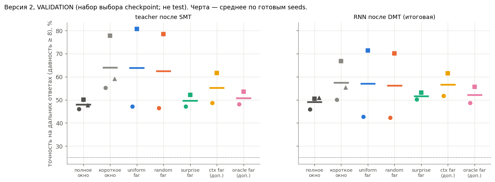

# Версия 2 (Stack): короткое окно SMT + MemUP-supervision дальних целей — промежуточно

**Только validation (набор выбора checkpoint), не test.** Обучения идут; таблица обновляется командой
`python make_v2_outputs.py --validation`. Значения взяты из лучшего checkpoint по validation CE, как в протоколе;
поэтому они могут немного отличаться от последней строки лога. Протокол и правило вывода — `proposals/preregistration_v2.md`.
Test — один раз после всех 18 обучений, с разрешения пользователя.

## Итоговая RNN (после DMT), точность на дальних ответах, % (validation)
Обновлено 14.10.2026, ~19:15. Готовы seeds 7 и 17 целиком и base_window seed 27.

| вариант | seed 7 | seed 17 | seed 27 |
|---|---|---|---|
| полное окно (версия 1, baseline; ориентир) | 45,9 | 50,5 | 50,9 |
| короткое окно (Tf = 8), без добавки | 50,1 | 66,7 | 55,4 |
| + все дальние цели (uniform_far) | 42,7 | 71,4 | идёт |
| + 2 случайные дальние (random_far) | 42,3 | 70,1 | идёт |
| **+ 2 неожиданные дальние, окно 8 (surprise_far)** | **50,2** | **53,2** | идёт |
| + 2 неожиданные по входам декодера (ctx_far, доп.) | 51,7 | 61,5 | идёт |
| + 2 дальние из памяти (oracle_far, доп.) | 48,7 | 55,7 | идёт |

Teacher после SMT, та же группа, %:

| вариант | seed 7 | seed 17 | seed 27 |
|---|---|---|---|
| полное окно | 46,0 | 50,1 | 47,7 |
| короткое окно | 55,2 | 77,8 | 59,1 |
| uniform_far | 47,1 | 80,7 | — |
| random_far | 46,5 | 78,5 | — |
| surprise_far | 47,2 | 52,2 | — |
| ctx_far | 48,7 | 61,7 | — |
| oracle_far | 48,1 | 53,5 | — |

## Что видно (предварительно)
* **Короткое окно само по себе лучше полного на всех трёх seeds:** итоговая RNN +4,2 / +16,2 / +4,5 п.п. На gate
  (seed 107) разница была ещё больше.
* **Главное сравнение — surprise_far против random_far — расходится по знаку:** +7,9 п.п. на seed 7 и −16,9 п.п.
  на seed 17. По заранее записанному правилу (одинаковый знак на всех seeds) эффект отбора при этом бюджете
  поддержан не будет, как бы ни лёг seed 27. Окончательно решит test.
* **Влияние дальних целей вообще зависит от seed:** на seed 7 random_far и uniform_far хуже короткого окна (−7…−8 п.п.),
  на seed 17 — лучше (+3…+5 п.п.).
* **Почему так нестабильно.** Навык дальних ответов «включается» скачком. При бюджете 3000 шагов он у одних прогонов
  успевает включиться, у других нет: например, teacher у surprise_far на seed 17 — 52%, у соседних вариантов 78–81%.
  Проверка сходимости C1 показала, что при достаточном обучении teacher решает задачу почти полностью (99% на validation,
  `outputs_convergence/README.md`). Значит, сравнивать отбор нужно в сходящемся режиме — это следующий шаг.

Файлы: `table_validation_by_seed.csv` (teacher, RNN, CE, far-memory probe), `figV2_validation.png`.
