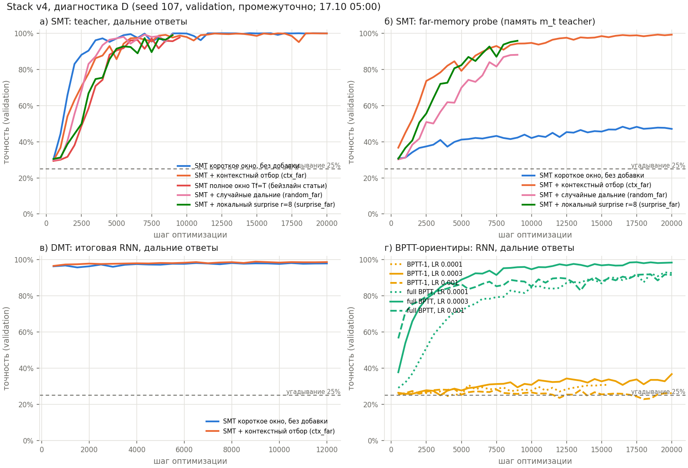
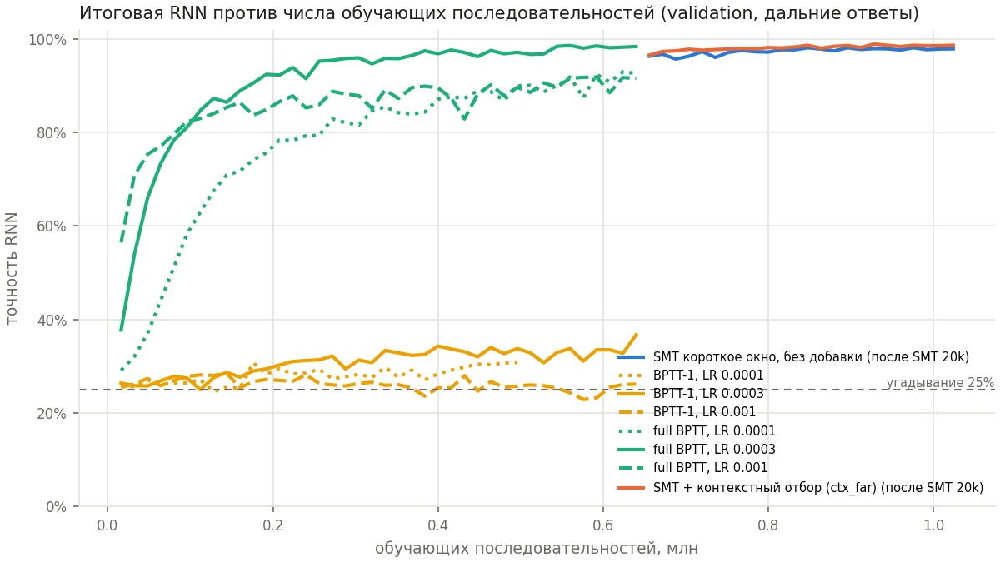

# Диагностическая очередь 16.10.2026 — графики и таблицы (обновляется автоматически)

**Обновлено 17.10.2026 05:00.** Только validation, промежуточные данные: пока задачи не завершены, это не результаты.
Собирает `python make_v4_outputs.py` из `runs/`. Протокол — `proposals/preregistration_v4.md`, статус — `status.md`.
Каталог запуска Stack: `runs/stackv4_d459c6921638`.

## Stack v4, часть D (seed 107)

Как читать:
* (а) teacher после SMT на дальних ответах (давность ≥ 8);
* (б) far-memory probe — хранит ли промежуточная память teacher m_t элемент. **Это не итоговая RNN**;
* (в) итоговая RNN в DMT;
* (г) BPTT-ориентиры, та же RNN с нуля: стиль линии = LR (точки 1e-4, сплошная 3e-4, штрихи 1e-3).

Прогресс:
* «шаги до плато» и «прирост за последнюю четверть» считаются по уже пройденным шагам;
* правило достаточности применяется только к завершённым обучениям.

| run | stage | steps_done | steps_max | best_acc | best_step | last_acc | gain_last_quarter_of_done | far_memory_acc_last | sec_per_step | train_hours | peak_allocated_mib |
|---|---|---|---|---|---|---|---|---|---|---|---|
| random_far | smt | 9000 | 10000 | 99.4% | 9000 | 99.4% | +1.4 п.п. | 88.1% | 0.34 | 0.85 | 7732 |
| surprise_far | smt | 9000 | 10000 | 98.9% | 9000 | 98.9% | +6.2 п.п. | 95.8% | 0.34 | 0.86 | 7732 |
| full_window | smt | 9500 | 10000 | 97.6% | 9500 | 97.6% | +1.4 п.п. | — | 0.33 | 0.87 | 7732 |
| base_window | smt | 20000 | 20000 | 100.0% | 14500 | 99.9% | +0.0 п.п. | 47.1% | 0.34 | 1.90 | 7732 |
| base_window | dmt | 12000 | 12000 | 98.1% | 6500 | 97.9% | +0.0 п.п. | — | 0.65 | 2.18 | 6444 |
| bptt_1_lr0.0001 | bptt | 15500 | 20000 | 30.8% | 15500 | 30.8% | +0.0 п.п. | — | 0.62 | 2.68 | 666 |
| bptt_1_lr0.0003 | bptt | 20000 | 20000 | 36.7% | 20000 | 36.7% | +2.4 п.п. | — | 0.62 | 3.44 | 666 |
| bptt_1_lr0.001 | bptt | 20000 | 20000 | 28.5% | 4500 | 26.2% | +0.0 п.п. | — | 0.62 | 3.44 | 666 |
| bptt_full_lr0.0001 | bptt | 20000 | 20000 | 93.0% | 19500 | 92.6% | +4.0 п.п. | — | 0.62 | 3.43 | 666 |
| bptt_full_lr0.0003 | bptt | 20000 | 20000 | 98.6% | 17500 | 98.4% | +1.0 п.п. | — | 0.61 | 3.38 | 666 |
| bptt_full_lr0.001 | bptt | 20000 | 20000 | 91.9% | 18500 | 91.6% | +1.7 п.п. | — | 0.62 | 3.44 | 666 |
| ctx_far | smt | 20000 | 20000 | 100.0% | 18500 | 99.9% | +0.1 п.п. | 99.2% | 0.34 | 1.91 | 7732 |
| ctx_far | dmt | 12000 | 12000 | 98.9% | 9000 | 98.6% | +0.0 п.п. | — | 0.66 | 2.19 | 6444 |

**Время шага** измерено под нагрузкой: до 7 процессов на одной GPU. Чистая стоимость одного процесса — в
`benchmark_rtx5090_2026-10-16.json`.

Решение по бюджетам финала: ещё нет (после всех 8 обучений: `python smt_memup_v4.py --phase diag_report`).

## MQAR, проверка A (pilot01) и Zoology, проверка Б
Графики и таблицы: `outputs_mqar/figA1_mqar_baselines.png`, `table_mqarA_progress.csv`, `table_mqarA_summary.csv`,
`table_zooB.csv`.

| job | steps_done | complete | val_long_acc | val_long_cand_acc | val_first_query_acc | train_set_acc |
|---|---|---|---|---|---|---|
| rnn_lr1e-3 | 20000 | True | 1.9% | 12.4% | 1.6% | — |
| rnn_lr1e-4 | 20000 | True | 1.1% | 13.1% | 2.0% | — |
| rnn_lr3e-4 | 20000 | True | 1.3% | 12.6% | 1.6% | — |
| rnn_overfit256 | 3000 | True | 1.6% | 12.6% | 2.1% | 99.1% |
| tf_lr1e-3 | 1000 | True | 99.8% | 99.9% | 100.0% | — |
| tf_lr3e-4 | 2000 | True | 100.0% | 100.0% | 100.0% | — |
| tf_overfit256 | 3000 | True | 5.2% | 13.0% | 8.6% | 100.0% |

| cell | run_id | epochs_run | final_valid_accuracy | independent_test_accuracy | early_stopped | complete |
|---|---|---|---|---|---|---|
| n256_d64 | attention-seqlen256-dmodel64-lr0.0001-kv16 | 64 | 5.2% | 5.3% | False | True |
| n256_d64 | attention-seqlen256-dmodel64-lr0.00046415888336127773-kv16 | 64 | 18.0% | 17.9% | False | True |
| n256_d64 | attention-seqlen256-dmodel64-lr0.002154434690031882-kv16 | 7 | 99.9% | 99.9% | True | True |
| n256_d64 | attention-seqlen256-dmodel64-lr0.01-kv16 | 5 | 100.0% | 100.0% | True | True |
| n64_d64 | attention-seqlen64-dmodel64-lr0.0001-kv4 | 64 | 25.5% | 26.5% | False | True |
| n64_d64 | attention-seqlen64-dmodel64-lr0.00046415888336127773-kv4 | 25 | 99.7% | 99.7% | True | True |
| n64_d64 | attention-seqlen64-dmodel64-lr0.002154434690031882-kv4 | 11 | 99.0% | 99.0% | True | True |
| n64_d64 | attention-seqlen64-dmodel64-lr0.01-kv4 | 7 | 99.3% | 99.4% | True | True |

## Файлы
* `table_diag_histories.csv` — все точки validation: run, stage, step, метрики, время, память.
* `table_diag_progress.csv` — сводка выше.
* Логи задач — `runs/jobs/*.log`, планировщик — `runs/gpu_jobs.log`.
* Истории и стоимость — `runs/stackv4_*/diag/*/`, `runs/mqar_baselines_*/*/`, `runs/zoology_repro/`. Checkpoints
  (`*.pt`) в git не входят.
